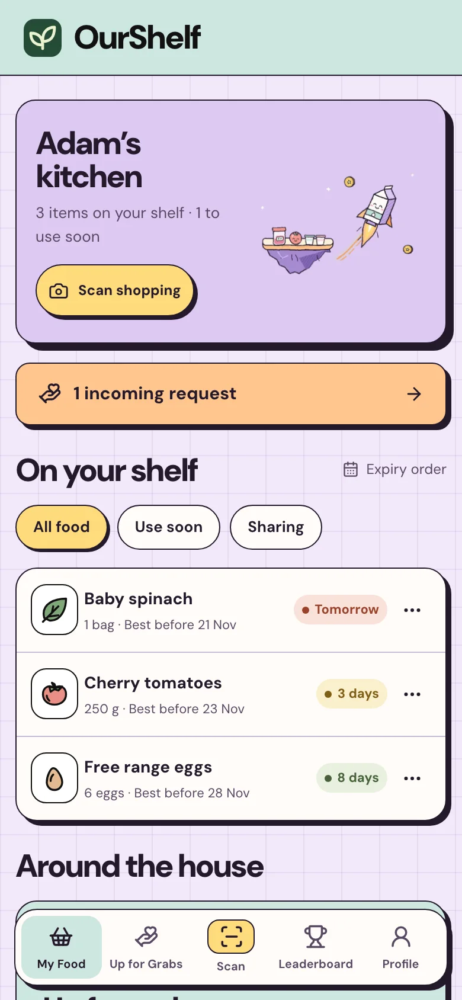
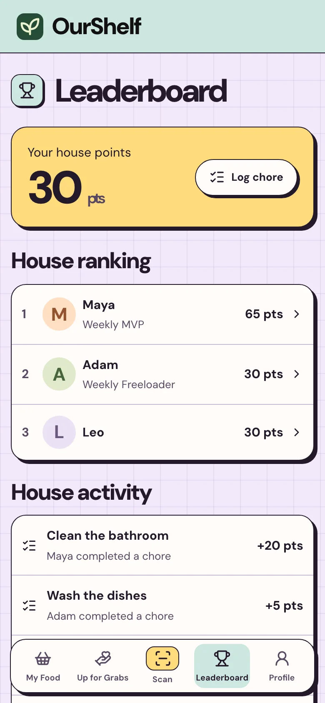
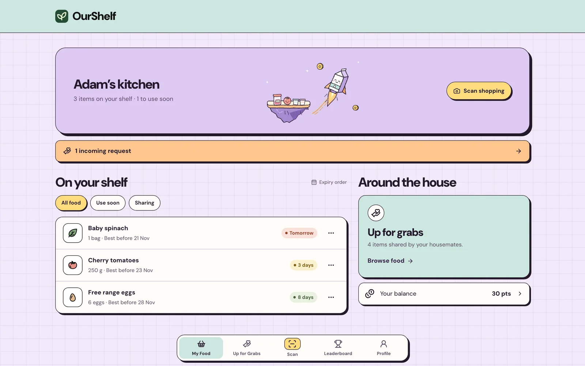

<h1 align="center">OurShelf</h1>

<p align="center">
  <strong>OurShelf helps housemates share food before it goes to waste and earn points for doing chores.</strong>
</p>

<p align="center">
  <a href="https://planourshelf.lovable.app/">Live app</a> ·
  <a href="#screenshots">Screenshots</a> ·
  <a href="#tech-stack">Tech stack</a> ·
  <a href="#run-locally">Run locally</a>
</p>

<p align="center">
  
</p>

Scan your groceries to see what needs using soon. Offer food to your housemates for free or for points they can earn by doing chores.

## Screenshots

OurShelf is a mobile-first web app with a separate desktop landing page. The in-app screens below use sample house data.

### Mobile

<table>
  <tr>
    <td align="center"><br><sub>Sign in</sub></td>
    <td align="center"><br><sub>My Food</sub></td>
    <td align="center"><br><sub>Up for Grabs</sub></td>
    <td align="center"><br><sub>Leaderboard</sub></td>
  </tr>
</table>

### Desktop

<p align="center">
  
</p>
<p align="center">
  
</p>

## Features

- **My Food** shows what’s on your shelf and flags items that need using soon.
- **Up for Grabs** lets you offer food for free or for points, then accept or decline requests from housemates.
- **Scan** automatically captures items as you point the camera at them. You can also upload photos or enter items manually.
- **Leaderboard** shows which chores each housemate has logged, how many points they’ve earned, and recent activity.
- **Shared houses** use email sign-in links and housemate invitations. Food, chores and balances sync across devices.
- **Original illustrations** include hand-drawn SVGs and WebP artwork.

## Tech stack

React, TanStack Start, TypeScript and Tailwind CSS power the app. Supabase handles sign-in and shared household data. The scanner uses Google Gemini through a Cloudflare Worker.

## Run locally

Use Node.js 22.12+ or 24 and Bun 1.3+.

```sh
bun install --frozen-lockfile
bun run dev
```

Sign-in and live scanning require their respective backend settings. Run the automated tests with `bun run test`.
