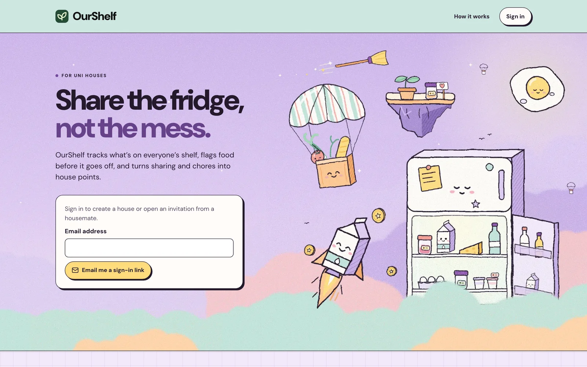
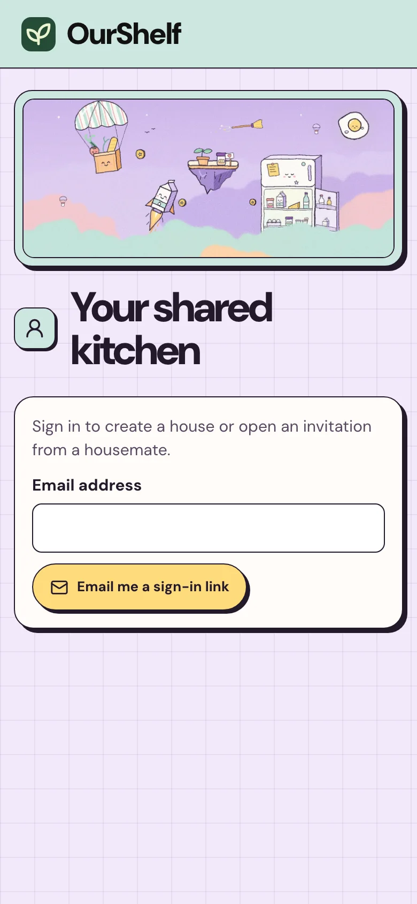
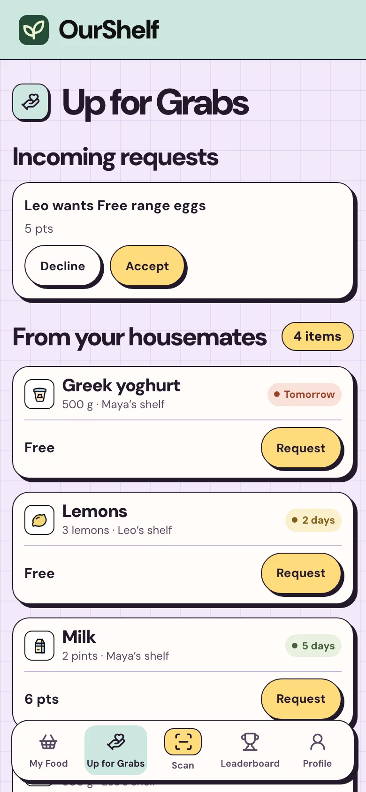
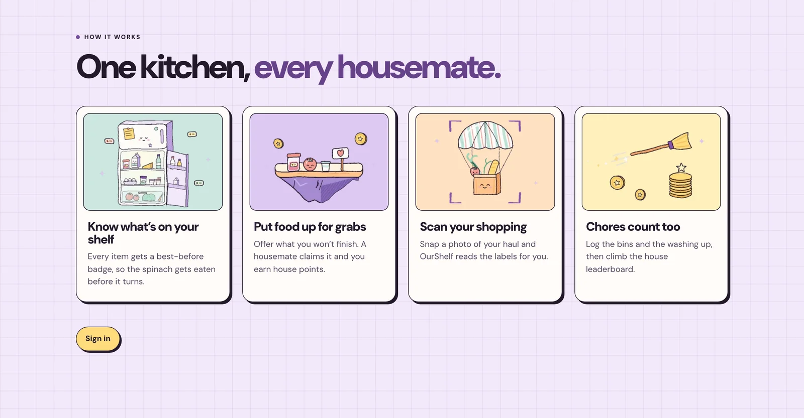

<h1 align="center">OurShelf</h1>

<p align="center">
  <strong>OurShelf helps housemates scan groceries and share food before it goes to waste, while a shared leaderboard shows who’s done their chores and how many points they’ve earned to spend on food.</strong>
</p>

<p align="center">
  <a href="https://test341.lovable.app/">Live app</a> ·
  <a href="#screenshots">Screenshots</a> ·
  <a href="#tech-stack">Tech stack</a> ·
  <a href="#run-locally">Run locally</a>
</p>

<p align="center">
  
</p>

## Why this one-liner

We chose that sentence because every clause maps to something you can do in the app, and together they explain why the features belong in one product.

| Part of the sentence                                   | What it points to                                                                                                   |
| ------------------------------------------------------ | ------------------------------------------------------------------------------------------------------------------- |
| **helps housemates**                                   | Built for shared houses, especially UK uni houses. Everything happens inside a house you create or are invited to.  |
| **scan groceries**                                     | The **Scan** tab. Point the camera at your shopping, and Gemini reads each label and its date.                      |
| **share food before it goes to waste**                 | **My Food** flags what is about to expire, and **Up for Grabs** lets you offer it to housemates before it goes off. |
| **a shared leaderboard shows who’s done their chores** | The **Leaderboard** tab: logged chores, a house ranking and an activity feed everyone can see.                      |
| **points they’ve earned to spend on food**             | The loop that ties it together. Chores earn points, and points pay for food housemates put up for grabs.            |

The last clause matters most. Without it, OurShelf would be a food tracker plus a chore chart, two separate tools. Because points are earned through chores and spent on shared food, doing the washing up gets you dinner, and food that would be binned gets eaten. One sentence tells a judge or a new housemate the problem (waste and chore arguments in shared kitchens), the features, and the reason they work together.

## Screenshots

OurShelf is a mobile-first web app with a separate desktop landing page. The in-app screens below use sample house data.

### Mobile

<table>
  <tr>
    <td align="center"><br><sub>Sign in</sub></td>
    <td align="center"><br><sub>My Food</sub></td>
    <td align="center"><br><sub>Up for Grabs</sub></td>
    <td align="center"><br><sub>Leaderboard</sub></td>
  </tr>
</table>

### Desktop

<p align="center">
  
</p>
<p align="center">
  
</p>

## Features

- **My Food:** each item on your shelf gets a red, amber or green badge for how soon it expires. You can filter by _Use soon_ or _Sharing_.
- **Up for Grabs:** offer food for free or for a price in points. Housemates request it, and you accept or decline.
- **Scan:** an in-page camera captures each item once it is held steady and sends batches to Gemini. Photo upload and manual entry are also available.
- **Leaderboard and chores:** log chores from the house's own chore list. Points, a house ranking, member chore histories and an activity feed update for everyone.
- **Shared houses:** email-link sign-in (no passwords), invite links for housemates, and live updates across devices.
- **Original artwork:** the illustrations were hand-drawn in code as SVG and rendered to WebP, not generated by AI.

## Tech stack

| Layer    | Tools                                                                                                 |
| -------- | ----------------------------------------------------------------------------------------------------- |
| Frontend | React 19, TanStack Start and Router (file routes), TanStack Query, Vite 8, TypeScript                 |
| Styling  | Tailwind CSS v4, hand-written CSS in `src/kitchen.css`, shadcn/ui, lucide icons, DM Sans              |
| Backend  | Lovable Cloud (Supabase Postgres and passwordless email auth), TanStack server functions              |
| Scanning | Cloudflare Worker with a Durable Object rate limiter, Google Gemini structured output, Zod validation |
| Hosting  | Lovable (Cloudflare via Nitro) for the app, Cloudflare Workers for the scanner                        |
| Quality  | Vitest and Testing Library, ESLint, Prettier                                                          |

### Project layout

```text
src/components/    screens: kitchen, scan, sharing, leaderboard, chores, houses
src/lib/           household logic, shared-house API, scan contract, auth
src/routes/        TanStack file routes
worker/            Cloudflare scanner Worker (Gemini and rate limits)
ops/               SQL for the Lovable backend
public/images/     illustrations
docs/screenshots/  images used in this README
```

## Run locally

Use Node.js 22.12+ or 24 and Bun 1.3+ with the committed lockfile.

```sh
git pull --ff-only
bun install --frozen-lockfile
bun run dev
```

Open the local URL printed by Vite. To test sign-in and house features, configure the backend and allow the local origin as an auth redirect.

## Enable My Houses in Lovable

1. In the Lovable project, enable the built-in backend and email authentication. Ask Lovable to provision the tables, privileges and functions in [ops/lovable-houses.sql](ops/lovable-houses.sql) through its database workflow.
2. Enable passwordless email links. Allow the app root as an auth redirect on both the preview origin and `https://test341.lovable.app/`.
3. Set the environment through Lovable’s backend bindings:
   - The browser needs `VITE_SUPABASE_URL` and `VITE_SUPABASE_PUBLISHABLE_KEY` (or `VITE_SUPABASE_ANON_KEY`).
   - The TanStack server needs `SUPABASE_URL` and `SUPABASE_SERVICE_ROLE_KEY`. The service-role key belongs only in Lovable’s server secrets.
4. In the preview, sign in, set a name, and create a house under **Profile → My Houses**. Generate an invite link, then open it in a separate browser profile and sign in with a second address. Open each email sign-in link in the browser that requested it.
5. Check that the second member sees the same house, and that food and points updates appear in the other browser. Publish once the preview passes.

## Connect live scanning

Live scanning is available to signed-in house members.

- The TanStack server checks membership and issues a one-minute scan grant.
- A Cloudflare Durable Object enforces six provider calls per user per minute, and 120 across the deployment per UTC day.
- In **Start scan**, the browser captures a steady item in the camera guide and sends up to four captures per provider call. **Upload photo** and manual entry are also available.

### Secrets

Generate a 32-byte base64url `SCAN_GRANT_SECRET`. Set the same value in the Lovable server secrets and the Cloudflare Worker secrets.

For local development:

- Set `SCAN_GRANT_SECRET` in the app’s `.env.local` and in `worker/.dev.vars`.
- Set `GEMINI_API_KEY` in `worker/.dev.vars`.

Keep both secrets out of frontend variables and Git.

### Local Worker

Run Wrangler from the repository root with the scanner configuration.

```sh
npx wrangler@4 dev --config worker/wrangler.toml
```

1. In the repository root, set `VITE_SCAN_API_URL=http://localhost:8787/scan` in `.env.local` and restart Vite.
2. Open the app at the localhost origin listed in `worker/wrangler.toml`.

To use the camera on a phone, open the HTTPS-hosted app or the device’s own localhost.

### Deploy

Before deploying:

- Set `ALLOWED_ORIGINS` in `worker/wrangler.toml` to the exact Lovable preview and published origins that will call the scanner, separated by commas.
- Confirm that the Google AI Studio key can use the configured Gemini model.

```sh
npx wrangler@4 deploy --config worker/wrangler.toml
npx wrangler@4 secret put GEMINI_API_KEY --config worker/wrangler.toml
npx wrangler@4 secret put SCAN_GRANT_SECRET --config worker/wrangler.toml
```

1. Deploy the Worker with batch scanning before publishing the frontend with **Start scan**.
2. Set the Lovable frontend build variable `VITE_SCAN_API_URL` to the deployed Worker URL, including `/scan`.
3. Rebuild.

How scanning behaves once deployed:

- The scanner sends photos to Google Gemini and validates the structured model responses.
- If a haul scan is unavailable, use manual entry.
- If a close-up shows a date without a year, the user is asked to enter the full date before saving.

## Verify

```sh
bun run test
bunx tsc --noEmit
bun run lint
bun run build
```

To run the local production build, start the generated Cloudflare entry:

```sh
npx wrangler@4 dev --local --config .output/server/wrangler.json
```

The automated Worker tests mock Gemini, so also test with real labels in the deployed preview:

1. Sign in as a house member and scan several real UK labels.
2. Include a numeric date with a year, a yearless date just before today, and a faint dot-matrix print.
3. Check the full date, the label type and the manual-entry fallback.
